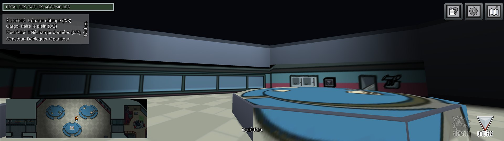
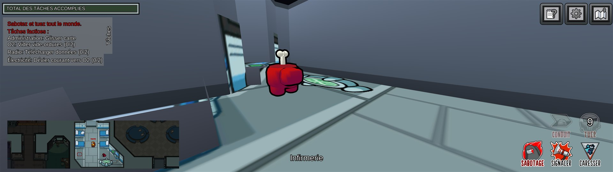

# AmongUs3D — jouer à Among Us en vue 3D

Mod **client** pour Among Us (Windows, BepInEx 6) qui remplace la vue de dessus par une **vraie vue 3D à la
première personne** : la souris dirige la caméra comme dans Minecraft, les murs et les meubles ont du volume,
et les joueurs sont de vrais petits personnages 3D.



| Un autre joueur | Un cadavre à signaler |
|---|---|
|  |  |

Le jeu lui-même n'est pas modifié : vitesse, collisions, tâches, votes, réseau… tout reste celui d'Among Us.
Les autres joueurs n'ont **pas** besoin du mod et ne voient aucune différence.

> Mod non officiel. Il n'apporte aucun avantage : il reproduit la vision du jeu, et une vue 3D voit même
> *moins* qu'une vue de dessus. Joue-le de préférence en partie privée avec tes amis.

---

## Ce que fait le mod

| Élément | En 3D |
|---|---|
| **Caméra** | Première personne (ou troisième personne avec F6). La souris tourne la caméra, haut/bas compris. En troisième personne, elle tourne autour du personnage : regarder vers le bas la fait monter, comme dans Minecraft. |
| **Déplacements** | Relatifs à la caméra : avancer, reculer, pas de côté. La vitesse et les collisions restent celles du jeu. |
| **Murs** | Construits là où le personnage bute réellement. Leur dessin d'origine (fenêtres, consoles de tâches, portes, sièges…) est **redressé à la verticale**. Les portes apparaissent quand elles se ferment. |
| **Meubles** | Tables, caisses, fauteuils… deviennent des blocs en volume avec leur dessus dessiné. |
| **Sol** | La carte 2D d'origine (bouches d'aération, surbrillances, décor) est plaquée au sol, mise à jour en direct. |
| **Personnages** | Vrais modèles 3D aux couleurs du joueur : corps, visière, sac à dos, jambes qui marchent, contour noir. Les cadavres aussi (demi-corps et os). Chapeau et nom restent affichés au-dessus. Animaux, fantômes et animations spéciales restent des images tournées vers la caméra. |
| **Vision** | Le rayon de vision du jeu est respecté : obscurité au-delà, joueurs invisibles hors de vue ou derrière un mur, sabotage des lumières, vision d'imposteur, vision totale des fantômes. |
| **Interface** | Le HUD du jeu (Utiliser, Signaler, Tuer, tâches, carte, chat) reste affiché par-dessus la 3D. |
| **Flèches de sabotage** | Elles suivent la caméra : posées juste au-dessus de l'endroit visé quand il est devant toi, sinon en boussole autour du centre de l'écran (en haut = devant, à droite = à droite, en bas = derrière). |
| **Mini-carte** | Une petite copie de la vue 2D normale, avec une flèche qui indique où tu regardes. |
| **Retour en 2D automatique** | Dans les **bouches d'aération** (pour cliquer sur les flèches), pendant les réunions, les éjections, l'intro et les mini-jeux (tâches, caméras, ordinateur…). Le curseur revient tout seul. |

---

## Commandes (PC)

Les touches de déplacement sont celles du jeu (ZQSD / WASD / flèches, selon tes réglages Among Us).

| Action | Commande |
|---|---|
| Regarder autour de soi | **Souris** (curseur caché, comme dans Minecraft) |
| Avancer / reculer / pas de côté | Touches de déplacement du jeu |
| Utiliser (tâche, bouton, **bouche d'aération**, caresser) | **Clic gauche**, ou la touche habituelle du jeu |
| Libérer le curseur pour cliquer sur l'interface | **Alt gauche maintenu** |
| Caméra à la souris oui / non | **F8** (sans la souris : gauche / droite tournent la caméra) |
| Sensibilité de la caméra − / + | **F10** / **F11** |
| 3D / 2D | **F5** |
| 1re / 3e personne | **F6** |
| Mini-carte | **F7** |
| Capture d'écran (dossier `BepInEx/AmongUs3D-captures`) | **F12** |
| Diagnostic dans le journal | **F9** |
| Tuer, Signaler, Carte… | Touches habituelles du jeu (Q, R, Tab…) |

Le curseur est rendu automatiquement dès qu'un menu, une tâche, le chat ou la carte est ouvert.

> Règle les contrôles d'Among Us sur **Clavier** ou **Clavier et souris** (pas « Souris seule »,
> qui envoie le personnage vers le curseur).

---

## Installation (Windows)

1. **Installe BepInEx 6 (IL2CPP)**, build *be.735* — celle des mods Among Us actuels :
   - Steam / itch.io : [BepInEx IL2CPP **x86**](https://builds.bepinex.dev/projects/bepinex_be/735/BepInEx-Unity.IL2CPP-win-x86-6.0.0-be.735%2B5fef357.zip)
   - Epic / Xbox / Microsoft Store : [BepInEx IL2CPP **x64**](https://builds.bepinex.dev/projects/bepinex_be/735/BepInEx-Unity.IL2CPP-win-x64-6.0.0-be.735%2B5fef357.zip)
2. Extrais le zip **dans le dossier du jeu** (là où se trouve `Among Us.exe`).
3. Lance le jeu **une première fois** (c'est long : BepInEx prépare ses fichiers), puis quitte.
4. Télécharge `AmongUs3D.dll` dans les [Releases](../../releases) et copie-le dans `Among Us/BepInEx/plugins/`.
5. Lance le jeu : la 3D s'active dès que tu entres dans un lobby ou une partie.

Pour désinstaller : supprime `BepInEx/plugins/AmongUs3D.dll`.

### Ce qui a été essayé

- **Essayé en jeu** (novembre 2026, Among Us 2026.9.29, version Microsoft Store / Xbox, BepInEx be.735 x64) :
  The Skeld, The Fungle, le lobby ; souris, tâches, réunion, bouches d'aération, imposteur, cadavres.
- **Pas encore essayé** : MIRA HQ, Polus, The Airship (le mod s'y construit de la même façon, mais attends-toi à
  des défauts d'affichage) et les versions Steam / Epic.
- **Android (Starlight)** : le code est prévu pour (commandes tactiles, boutons à l'écran), mais il n'a jamais
  tourné sur un téléphone, et Starlight ne charge que les mods approuvés par son équipe.

Si une fonction du jeu manque ou qu'une erreur se répète, le mod coupe seulement la partie concernée, ou
repasse en 2D normale, au lieu de faire planter le jeu.

---

## Réglages

Après un premier lancement, le fichier **`BepInEx/config/fr.mods.amongus3d.cfg`** est créé.
Ouvre-le avec un éditeur de texte (jeu fermé). Les plus utiles :

| Réglage | Défaut | Effet |
|---|---|---|
| `SourisCommeMinecraft` | `true` | La souris dirige la caméra dès l'entrée en 3D. |
| `SensibiliteSouris` | `0.2` | Degrés par point de souris (Minecraft à 100 % = 0.15). F10 / F11 la changent en jeu. |
| `VitesseRotation` | `240` | Degrés par seconde au clavier, quand la souris est libre. |
| `ClicGaucheUtiliser` | `true` | Le clic gauche fait « Utiliser ». |
| `InclinaisonMax` | `60` | Angle maximal pour regarder vers le haut ou le bas. |
| `RotationParPas` | `0` | `90` = un quart de tour par appui (souris libre). |
| `ChampDeVision` / `HauteurDesYeux` | `70` / `0.55` | Caméra à la première personne. |
| `Personnages3D` / `TaillePersonnages3D` | `true` / `1` | Modèles 3D des joueurs ; `false` = images plates. |
| `Fleches3D` | `true` | Flèches de sabotage orientées selon la caméra ; `false` = flèches de la vue de dessus. |
| `MursDebout` | `true` | Dessin des murs redressé ; `false` = ancien rendu à plat. |
| `MursExterieurs` | `Auto` | Murs aux limites de la carte (cartes d'intérieur seulement en `Auto`). |
| `HauteurDesMurs` / `HauteurDesObstacles` | `2` / `0.3` | Hauteur des murs et des meubles. |
| `DistanceDeVueDuSol` / `ResolutionDuSol` | `14` / auto | Zone et finesse du décor (à baisser si le jeu rame). |
| `SimulerLaVision` / `LumiereDansLObscurite` | `true` / `0.16` | Vision du jeu et luminosité hors vision. |
| `Vue2DDansLesBouches` | `true` | Retour en 2D dans les bouches d'aération. |
| `MiniCarteAuDemarrage` / `TailleMiniCarte` | `true` / `0.28` | Mini-carte. |

## Dépannage

Le journal est **`BepInEx/LogOutput.log`**. **F9** y écrit un diagnostic complet (caméras, murs, personnages).

| Problème | Piste |
|---|---|
| La souris est trop lente ou trop rapide | **F10 / F11** en jeu, ou `SensibiliteSouris`. |
| Je n'arrive pas à cliquer sur un bouton | Maintiens **Alt gauche**, ou appuie sur **F8**. |
| Des murs bizarres sur une carte | `MursDebout = false` pour revenir au rendu simple, puis envoie le journal. |
| Les personnages 3D ne te plaisent pas | `Personnages3D = false`. |
| Le jeu rame | `ResolutionDuSol = 1024`, `DistanceDeVueDuSol = 10`, `MiniCarteAuDemarrage = false`. |
| « Trop d'erreurs : vue 3D désactivée » | Le mod s'est mis en sécurité : envoie `LogOutput.log`. |

## Limites connues

- Les décors d'Among Us sont des dessins 2D : de très près, le dessin redressé des murs est flou.
- Skins et visières cosmétiques ne sont pas affichés sur les modèles 3D (le chapeau, oui).
- Pas de plafond : au-dessus des murs, c'est la couleur de fond.
- Les murs ne suivent pas les plateformes mobiles (The Airship).

---

## Compiler soi-même

Prérequis : [SDK .NET 8 ou plus récent](https://dotnet.microsoft.com/download).

```bash
dotnet build AmongUs3D.csproj -c Release
```

La compilation télécharge les bibliothèques officielles du jeu (flux `nuget.bepinex.dev`). La DLL est dans
`bin/Release/net6.0/AmongUs3D.dll`.

Avec le jeu installé (BepInEx lancé une fois), on peut compiler contre ses propres fichiers et installer le mod
d'un coup :

```bash
dotnet build AmongUs3D.csproj -c Release -p:GameDir="C:\XboxGames\Among Us\Content"
```

Tests de la partie mathématique (aucun jeu requis) :

```bash
dotnet run --project tests/AmongUs3D.Tests.csproj -c Release
```

| Fichier | Rôle |
|---|---|
| `src/Plugin.cs` | Point d'entrée BepInEx |
| `src/View3D.cs` | Chef d'orchestre : quand activer la 3D, mise à jour à chaque image |
| `src/Rig.cs` | Caméras : 3D, sol (carte vue de dessus), interface, mini-carte |
| `src/WallSystem.cs` | Collisions de la carte → murs, faces redressées, meubles, portes, éclairage |
| `src/ProxySystem.cs` | Joueurs, animaux, cadavres |
| `src/CrewShape.cs`, `src/CrewModel.cs` | Forme et modèle 3D des personnages |
| `src/Controls.cs`, `src/MovementPatch.cs` | Caméra (souris, clavier, tactile) et déplacements relatifs à la caméra |
| `src/Game.cs`, `src/InputCompat.cs` | Accès protégé au jeu et aux entrées |
| `src/MathUtil.cs` | Mathématiques pures (testées) |

---

## Mentions

Mod de fan, sous licence [MIT](LICENSE). This mod is not affiliated with Among Us or Innersloth LLC, and the
content contained therein is not endorsed or otherwise sponsored by Innersloth LLC. Portions of the materials
contained herein are property of Innersloth LLC. © Innersloth LLC.

À ne pas confondre avec *Among Us 3D*, le jeu officiel séparé d'Innersloth et Schell Games : ce mod transforme
le Among Us classique.
