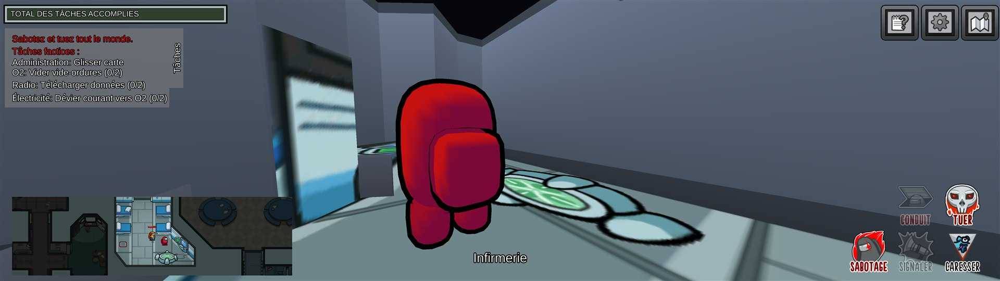
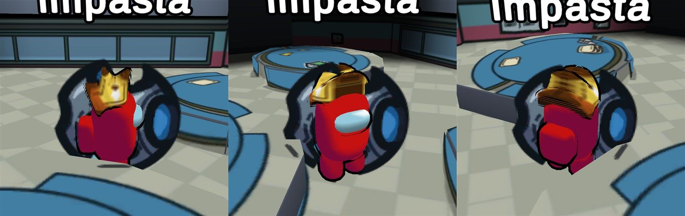
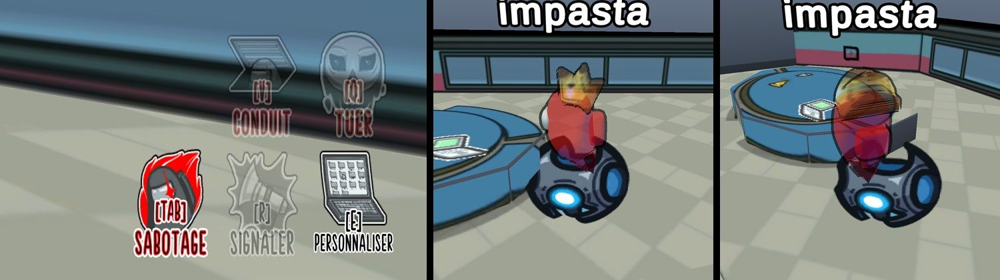

# AmongUs3D — jouer à Among Us en vue 3D

Mod **client** pour Among Us (Windows, BepInEx 6) qui remplace la vue de dessus par une **vraie vue 3D à la
première personne** : la souris dirige la caméra comme dans Minecraft, les murs et les meubles ont du volume,
et les joueurs sont de vrais petits personnages 3D.


| Un autre joueur | Un cadavre à signaler |
|---|---|
|  |  |

**Nouveau dans la 1.1** : chapeaux en volume (ici une couronne, de côté, de face et de dos), fantômes 3D quand
on est mort, touches du clavier écrites sur les boutons, et la caresse de l'animal enfin visible.





Le jeu lui-même n'est pas modifié : vitesse, collisions, tâches, votes, réseau… tout reste celui d'Among Us.
Les autres joueurs n'ont **pas** besoin du mod et ne voient aucune différence.

> Mod non officiel. Il n'apporte aucun avantage : il reproduit la vision du jeu, et une vue 3D voit même
> *moins* qu'une vue de dessus. Joue-le de préférence en partie privée avec tes amis.

---

## Ce que fait le mod

| Élément | En 3D |
|---|---|
| **Caméra** | Première personne (ou troisième personne avec F6). La souris tourne la caméra, haut/bas compris. En troisième personne, elle tourne autour du personnage : regarder vers le bas la fait monter, comme dans Minecraft. |
| **Déplacements** | Relatifs à la caméra : avancer, reculer, pas de côté. La vitesse et les collisions restent celles du jeu. |
| **Murs** | Construits là où le personnage bute réellement. Leur dessin d'origine (fenêtres, consoles de tâches, portes, sièges…) est **redressé à la verticale**. Les portes apparaissent quand elles se ferment. Les murs sont **complets** : les trous dans un mur droit et les côtés de salle dont la cloison est en retrait sont refermés à pleine hauteur. |
| **Meubles** | De **vrais objets modelés en 3D**, comme dans Blender : tables rondes à pied central entourées de bancs, bouton d'urgence en dôme rouge, consoles inclinées, caisses à cadre, lits (même collés à une cloison), chaises de bureau. Les meubles non reconnus gardent leur forme, avec des arêtes arrondies et une plinthe, y compris les objets adossés à un mur (cœur du réacteur, pupitre de la sécurité…). Le dessus et les faces avant restent peints avec le dessin du jeu. |
| **Sol** | La carte 2D d'origine (bouches d'aération, surbrillances, décor) est plaquée au sol, mise à jour en direct. |
| **Personnages** | Vrais modèles 3D aux couleurs du joueur : corps, visière, sac à dos, jambes qui marchent, contour noir. Les cadavres aussi (demi-corps et os). Le nom reste affiché au-dessus. |
| **Animations** | Elles sont jouées **en 3D**. Quand un joueur est tué, son corps **tombe à plat** sur le sol, dans la direction où il regardait, avec un petit rebond. Tué par la **Vipère**, le corps s'affaisse, verdit et **se dissout** dans une flaque d'acide, au rythme du jeu. Les joueurs **sautent dans les bouches d'aération** et en ressortent, grimpent aux échelles dos à toi, et apparaissent en grandissant. |
| **Chapeaux et accessoires** | Ils deviennent des **objets en volume**, fabriqués à partir de leur dessin : le chapeau posé sur la tête, la **visière** sur l'avant du visage, l'**animal** qui te suit (il se tourne dans le sens de la marche et sautille). De côté on retrouve le dessin du jeu, de face et de trois quarts ils ont une vraie épaisseur arrondie, avec un contour noir. La **combinaison** est peinte sur le corps et les jambes 3D. |
| **Inventaire** | Dans le menu Inventaire, ton personnage est montré **en 3D** (avec chapeau, visière et combinaison) et tourne doucement sur lui-même. **F5** repasse l'aperçu en 2D (et inversement). |
| **Fantômes** | Quand tu meurs, la vue **reste en 3D** et tu deviens un **fantôme 3D** transparent qui flotte, avec une queue à la place des jambes (ton chapeau aussi). Les autres fantômes sont en 3D de la même façon. |
| **Animaux** | Quand tu caresses ton animal, la main et les cœurs s'affichent **sur l'animal**. En 1re personne, la caméra recule un peu et se tourne vers lui le temps de l'animation. |
| **Touches sur les boutons** | En petit, en bas de chaque bouton du jeu (Tuer, Sabotage, Conduit, Signaler, Utiliser, Capacité, Caresser, Carte…), la touche du clavier qui fait la même chose, lue dans tes réglages de touches d'Among Us. La lettre affichée est celle de **ton** clavier : le jeu repère les touches par leur place, donc sur un clavier français (AZERTY) « Tuer » est sur **A**. |
| **Vision** | Le rayon de vision du jeu est respecté : obscurité au-delà, joueurs invisibles hors de vue ou derrière un mur, sabotage des lumières, vision d'imposteur, vision totale des fantômes. |
| **Interface** | Le HUD du jeu (Utiliser, Signaler, Tuer, tâches, carte, chat) reste affiché par-dessus la 3D. |
| **Flèches de sabotage** | Elles suivent la caméra : posées juste au-dessus de l'endroit visé quand il est devant toi, sinon en boussole autour du centre de l'écran (en haut = devant, à droite = à droite, en bas = derrière). |
| **Mini-carte** | Une petite copie de la vue 2D normale, avec une flèche qui indique où tu regardes. |
| **Retour en 2D automatique** | Dans les **bouches d'aération** (pour cliquer sur les flèches), pendant les réunions, les éjections, l'intro et les mini-jeux (tâches, caméras, ordinateur…). Le curseur revient tout seul. |

---

## Commandes (PC)

Les touches de déplacement sont celles du jeu (ZQSD / WASD / flèches, selon tes réglages Among Us).

| Action | Commande |
|---|---|
| Regarder autour de soi | **Souris** (curseur caché, comme dans Minecraft) |
| Avancer / reculer / pas de côté | Touches de déplacement du jeu |
| Utiliser (tâche, bouton, **bouche d'aération**, caresser) | **Clic gauche**, ou la touche habituelle du jeu |
| Libérer le curseur pour cliquer sur l'interface | **Alt gauche maintenu** |
| Caméra à la souris oui / non | **F8** (sans la souris : gauche / droite tournent la caméra) |
| Sensibilité de la caméra − / + | **F10** / **F11** |
| 3D / 2D | **F5** (dans l'inventaire : aperçu du personnage en 3D / 2D) |
| 1re / 3e personne | **F6** |
| Mini-carte | **F7** |
| Capture d'écran (dossier `BepInEx/AmongUs3D-captures`) | **F12** |
| Diagnostic dans le journal | **F9** |
| Tuer, Sabotage, Signaler, Carte… | Touches habituelles du jeu, **écrites en petit sur chaque bouton** (par défaut Q, Tab, R, Tab…) |

Le curseur est rendu automatiquement dès qu'un menu, une tâche, le chat ou la carte est ouvert.

> Règle les contrôles d'Among Us sur **Clavier** ou **Clavier et souris** (pas « Souris seule »,
> qui envoie le personnage vers le curseur).

---

## Installation (Windows)

1. **Installe BepInEx 6 (IL2CPP)**, build *be.735* — celle des mods Among Us actuels :
   - Steam / itch.io : [BepInEx IL2CPP **x86**](https://builds.bepinex.dev/projects/bepinex_be/735/BepInEx-Unity.IL2CPP-win-x86-6.0.0-be.735%2B5fef357.zip)
   - Epic / Xbox / Microsoft Store : [BepInEx IL2CPP **x64**](https://builds.bepinex.dev/projects/bepinex_be/735/BepInEx-Unity.IL2CPP-win-x64-6.0.0-be.735%2B5fef357.zip)
2. Extrais le zip **dans le dossier du jeu** (là où se trouve `Among Us.exe`).
3. Lance le jeu **une première fois** (c'est long : BepInEx prépare ses fichiers), puis quitte.
4. Télécharge `AmongUs3D.dll` dans les [Releases](../../releases) et copie-le dans `Among Us/BepInEx/plugins/`.
5. Lance le jeu : la 3D s'active dès que tu entres dans un lobby ou une partie.

Pour désinstaller : supprime `BepInEx/plugins/AmongUs3D.dll`.

### Ce qui a été essayé

- **Essayé en jeu** (novembre 2026, Among Us 2026.9.29, version Microsoft Store / Xbox, BepInEx be.735 x64) :
  The Skeld, The Fungle, le lobby ; souris, tâches, réunion, bouches d'aération, imposteur, cadavres.
  Version 1.1 : touches sur les boutons (équipier et imposteur), chapeau 3D, caresse de l'animal et fantôme 3D
  (rôle d'ange gardien de l'Entraînement), sur The Skeld.
  Version 1.3, sur The Skeld en Entraînement : les quatre lits de l'infirmerie en 3D, le mur du couloir nord
  complété ; un mannequin tué dont le corps bascule et finit couché à plat ; en Vipère, le corps qui se dissout
  dans sa flaque en 15 secondes environ ; le saut dans une bouche d'aération et la sortie (vus à la 3e personne
  avec `Vue2DDansLesBouches = false`) ; la touche [A] affichée sur « Tuer » avec un clavier français.
- **Pas encore essayé** : MIRA HQ, Polus, The Airship (le mod s'y construit de la même façon, mais attends-toi à
  des défauts d'affichage) et les versions Steam / Epic. Pour la version 1.3 : les échelles et
  l'apparition (il n'y a pas d'échelle sur The Skeld), le saut d'un autre joueur dans une bouche (essayé seulement
  avec son propre personnage), les murs complétés des autres cartes.
- **Android (Starlight)** : le code est prévu pour (commandes tactiles, boutons à l'écran), mais il n'a jamais
  tourné sur un téléphone, et Starlight ne charge que les mods approuvés par son équipe.

Si une fonction du jeu manque ou qu'une erreur se répète, le mod coupe seulement la partie concernée, ou
repasse en 2D normale, au lieu de faire planter le jeu.

---

## Réglages

Après un premier lancement, le fichier **`BepInEx/config/fr.mods.amongus3d.cfg`** est créé.
Ouvre-le avec un éditeur de texte (jeu fermé). Les plus utiles :

| Réglage | Défaut | Effet |
|---|---|---|
| `SourisCommeMinecraft` | `true` | La souris dirige la caméra dès l'entrée en 3D. |
| `SensibiliteSouris` | `0.2` | Degrés par point de souris (Minecraft à 100 % = 0.15). F10 / F11 la changent en jeu. |
| `VitesseRotation` | `240` | Degrés par seconde au clavier, quand la souris est libre. |
| `ClicGaucheUtiliser` | `true` | Le clic gauche fait « Utiliser ». |
| `InclinaisonMax` | `60` | Angle maximal pour regarder vers le haut ou le bas. |
| `RotationParPas` | `0` | `90` = un quart de tour par appui (souris libre). |
| `ChampDeVision` / `HauteurDesYeux` | `70` / `0.55` | Caméra à la première personne. |
| `Personnages3D` / `TaillePersonnages3D` | `true` / `1` | Modèles 3D des joueurs ; `false` = images plates. |
| `Chapeaux3D` | `true` | Chapeaux en volume ; `false` = chapeaux plats tournés vers la caméra. |
| `Accessoires3D` | `true` | Visière, combinaison et animal en 3D ; `false` = visière et combinaison masquées sur les modèles 3D, animal en image plate. |
| `Inventaire3D` | `true` | Aperçu 3D du personnage dans l'inventaire (F5 le change aussi). |
| `Fantomes3D` | `true` | Fantômes en 3D ; `false` = images plates. |
| `TouchesSurLesBoutons` | `true` | Touches du clavier écrites sur les boutons du jeu. |
| `RegarderLAnimalCaresse` | `true` | En 1re personne, la caméra se tourne vers l'animal pendant la caresse. |
| `Fleches3D` | `true` | Flèches de sabotage orientées selon la caméra ; `false` = flèches de la vue de dessus. |
| `MursDebout` | `true` | Dessin des murs redressé ; `false` = ancien rendu à plat. |
| `Decor3D` | `true` | Meubles modelés en 3D ; `false` = anciens blocs extrudés. |
| `MursComplets` | `true` | Murs restés bas complétés à pleine hauteur, objets adossés aux murs en volume ; `false` = rendu de la version 1.2. |
| `Animations3D` | `true` | Chute des corps, dissolution par la Vipère, bouches d'aération, échelles et apparition en 3D ; `false` = cadavre debout, images plates pendant ces animations. |
| `MursExterieurs` | `Auto` | Murs aux limites de la carte (cartes d'intérieur seulement en `Auto`). |
| `HauteurDesMurs` / `HauteurDesObstacles` | `2` / `0.3` | Hauteur des murs et des meubles. |
| `DistanceDeVueDuSol` / `ResolutionDuSol` | `14` / auto | Zone et finesse du décor (à baisser si le jeu rame). |
| `SimulerLaVision` / `LumiereDansLObscurite` | `true` / `0.16` | Vision du jeu et luminosité hors vision. |
| `Vue2DDansLesBouches` | `true` | Retour en 2D dans les bouches d'aération. |
| `MiniCarteAuDemarrage` / `TailleMiniCarte` | `true` / `0.28` | Mini-carte. |

## Dépannage

Le journal est **`BepInEx/LogOutput.log`**. **F9** y écrit un diagnostic complet (caméras, murs, personnages).

| Problème | Piste |
|---|---|
| La souris est trop lente ou trop rapide | **F10 / F11** en jeu, ou `SensibiliteSouris`. |
| Je n'arrive pas à cliquer sur un bouton | Maintiens **Alt gauche**, ou appuie sur **F8**. |
| Des murs bizarres sur une carte | `MursComplets = false` d'abord, puis `MursDebout = false` pour revenir au rendu simple, et envoie le journal. |
| Les personnages 3D ne te plaisent pas | `Personnages3D = false`. |
| Un chapeau 3D a une forme bizarre | `Chapeaux3D = false` remet les chapeaux plats. |
| Un meuble 3D a une forme bizarre | `Decor3D = false` remet les blocs simples. |
| Le jeu rame | `ResolutionDuSol = 1024`, `DistanceDeVueDuSol = 10`, `MiniCarteAuDemarrage = false`. |
| « Trop d'erreurs : vue 3D désactivée » | Le mod s'est mis en sécurité : envoie `LogOutput.log`. |

## Limites connues

- Les décors d'Among Us sont des dessins 2D : de très près, le dessin redressé des murs est flou.
- La combinaison est peinte sur le corps 3D d'après son dessin de profil : ses petits détails sont simplifiés.
- Dans l'inventaire, l'animal reste en 2D à côté du personnage 3D.
- Un chapeau 3D est fabriqué à partir de son dessin vu de côté : de face, son épaisseur est devinée (arrondie).
  Un chapeau ou une visière animés restent figés sur une image.
- Pas de plafond : au-dessus des murs, c'est la couleur de fond.
- Les murs ne suivent pas les plateformes mobiles (The Airship).

---

## Compiler soi-même

Prérequis : [SDK .NET 8 ou plus récent](https://dotnet.microsoft.com/download).

```bash
dotnet build AmongUs3D.csproj -c Release
```

La compilation télécharge les bibliothèques officielles du jeu (flux `nuget.bepinex.dev`). La DLL est dans
`bin/Release/net6.0/AmongUs3D.dll`.

Avec le jeu installé (BepInEx lancé une fois), on peut compiler contre ses propres fichiers et installer le mod
d'un coup :

```bash
dotnet build AmongUs3D.csproj -c Release -p:GameDir="C:\XboxGames\Among Us\Content"
```

Tests de la partie mathématique (aucun jeu requis) :

```bash
dotnet run --project tests/AmongUs3D.Tests.csproj -c Release
```

| Fichier | Rôle |
|---|---|
| `src/Plugin.cs` | Point d'entrée BepInEx |
| `src/View3D.cs` | Chef d'orchestre : quand activer la 3D, mise à jour à chaque image |
| `src/Rig.cs` | Caméras : 3D, sol (carte vue de dessus), interface, mini-carte |
| `src/WallSystem.cs` | Collisions de la carte → murs, faces redressées, meubles, portes, éclairage |
| `src/WallRules.cs` | Règles pures (testées) : côté praticable, murs à compléter, objets adossés |
| `src/ProxySystem.cs` | Joueurs, animaux, cadavres |
| `src/CrewShape.cs`, `src/CrewModel.cs` | Forme et modèle 3D des personnages (vivants, cadavres, fantômes) |
| `src/HatShape.cs`, `src/HatCapture.cs` | Chapeaux 3D : photo du dessin du chapeau, puis volume « gonflé » |
| `src/KeyHints.cs` | Touches du clavier écrites sur les boutons du jeu |
| `src/Controls.cs`, `src/MovementPatch.cs` | Caméra (souris, clavier, tactile) et déplacements relatifs à la caméra |
| `src/Game.cs`, `src/InputCompat.cs` | Accès protégé au jeu et aux entrées |
| `src/MathUtil.cs` | Mathématiques pures (testées) |

---

## Mentions

Mod de fan, sous licence [MIT](LICENSE). This mod is not affiliated with Among Us or Innersloth LLC, and the
content contained therein is not endorsed or otherwise sponsored by Innersloth LLC. Portions of the materials
contained herein are property of Innersloth LLC. © Innersloth LLC.

À ne pas confondre avec *Among Us 3D*, le jeu officiel séparé d'Innersloth et Schell Games : ce mod transforme
le Among Us classique.
